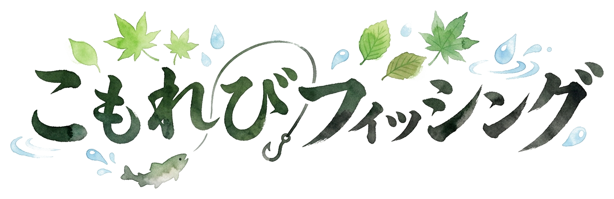

<p align="center">
  
</p>

<p align="center">
  <strong>〜 水彩の世界とおじさんの釣り日誌 〜</strong><br>
  <em>水彩画の湖畔を舞台にした、心温まる見下ろし型HD-2D探索釣りゲーム</em>
</p>

---

## 📖 ゲーム概要

『こもれびフィッシング』は、水彩絵本のような美しい自然を舞台に、デフォルメされた愛らしいおじさん釣り人と一緒に水辺を探索し、魚釣りを楽しむコージーゲーム（Cozy Game）です。

水面にゆらめく魚影を見極めてキャストし、アタリの瞬間にアワセを決め、リール巻き上げミニゲームで魚とのファイト！
釣った魚をよろず屋で売って新しい竿やエサ、探索道具（ゴム長靴・木こりのオノ・手漕ぎボート）を手に入れ、秘密の滝壺や湖の孤島を開拓してお魚図鑑のコンプリートを目指しましょう！

---

## ✨ 主な特徴

### 1. 🎨 水彩画の世界とHD-2Dグラフィック
- 本物の水彩画テクスチャで描かれた草地、川、池、木々、満開の桜。
- 画面全体を包む水彩紙フィルターと、舞い散る木漏れ日・花びらのパーティクル演出。
- 筆文字の手書きタイトルロゴが迎える美しいタイトル画面。

### 2. 🚶 かわいいおじさん釣り人
- ドラクエ風の上下左右4方向歩行アクション。
- ぽっこりお腹のデニムサロペット、麦わらバケットハット、白い口髭と赤い丸鼻の愛嬌あふれるキャラクター。
- 桟橋や水際でのキャスト、竿のしなりアニメーション。

### 3. 🌊 魚影システム（シルエット）
- マップ上の水面では、魚の正体は半透明の青暗い「魚影」としてゆらゆら回泳。
- 「小さな魚影」「素早い魚影」「大きな魚影」「金色にきらめく巨大魚影」など、影の大きさと動きから魚種を推測して狙いを定めます。
- 釣り上げて初めてフルカラーの実在魚イラストと名前が判明する、ドキドキと発見の楽しさ！

### 4. 🌀 リール巻き上げファイト ＆ 釣果演出
- ウキが引き込まれた【💥 HIT!!】の瞬間にすかさずクリック！
- 暴れる魚アイコンを緑の枠にキープし続けるリール巻き上げミニゲーム。
- 釣り上げると実測サイズ（cm）、レア度、価格、生態解説が表示。
- 初めての魚には「🎉 【新種発見！】」、自己ベスト更新時には「👑 【大物記録更新！】」の記念バッジ演出！

### 5. 🏪 水辺のよろず屋 ＆ 探索エリア開拓
- 釣った魚を売却してコイン（G）を獲得！
- **釣り竿**: 木の枝竿、竹のしなやか竿、炭素繊維の清流竿、名人の月影竿（パワー・枠サイズ向上）。
- **エサ**: みみず、だんごエサ、きらめくルアー（引き寄せ範囲拡大＆大物サイズ補正）。
- **探索道具（Key Items）**:
  - 🥾 **ゴム長靴**: 川の浅瀬をジャブジャブ渡り「西の原生林（イワナ生息地）」へ！
  - 🪓 **木こりのオノ**: 北の倒木を切り払い「秘密のエメラルド滝壺（ニジマス生息地）」へ！
  - ⛵ **手漕ぎボート**: 湖を漕ぎ出し「神秘の孤島（黄金の主生息地）」へ！

### 6. 📘 こもれびお魚図鑑
- タイトル画面およびゲーム本編（【B】キー）から手帳を開くようにいつでも閲覧可能。
- 実在魚全8種類（メダカ、ヤマメ、ギンブナ、ニシキゴイ、ナマズ、イワナ、ニジマス、黄金の主）。
- 発見度%、未発見シルエット・生息地ヒント、自己ベスト最大記録👑、累計釣果数、絵本風生態解説。

### 7. 🎵 オリジナルBGM ＆ 効果音（SFX）
- **タイトルBGM**: 『こもれびの湖畔で』（アコースティックギターとオルゴールの優しいワルツ）
- **フィールドBGM**: 『おじさんの釣り日誌』（素朴な木管フルートとフィンガーピッキングギターのカントリーフォーク）
- **各種効果音**: 水面キャスト音、HITチャイム、リール回転音、釣り上げ成功ファンファーレ、コイン音、ページめくり音、おじさんの足音。

---

## 🎮 操作方法

| キー / マウス | アクション |
| :--- | :--- |
| **【W】【A】【S】【D】** / **【矢印キー】** | おじさんの移動（4方向歩行） |
| **【マウス左クリック】** (水面) | ウキを投げる（キャスト） / 待機中の回収 |
| **【マウス左クリック】** / **【Space】** (HIT時) | アワセ（HITした瞬間に押してファイト開始！） |
| **【マウス左長押し】** / **【Space長押し】** (ファイト時) | リールを巻いて緑枠を動かす |
| **【E】キー** | 調べる（よろず屋に入る / 倒木を切る / ボートに乗る） |
| **【B】キー** / **【J】キー** | お魚図鑑を開く / 閉じる |
| **【Esc】キー** | モーダル・図鑑・あそびかたを閉じる |

---

## 🚀 起動方法

本プロジェクトは **Godot Engine 4**（推奨: Godot 4.3+ / 4.6+）で動作します。

### Godot エディタから起動
1. Godot Engine を起動し、「インポート」から本フォルダの `project.godot` を選択。
2. エディタ右上の「実行（F5）」ボタンを押す。

### コマンドラインから起動
```bash
# macOS の例
/Applications/Godot.app/Contents/MacOS/Godot --path /path/to/cozy-fishing-game
```

---

## 📂 プロジェクト構成

```
cozy-fishing-game/
├── project.godot               # Godot プロジェクト設定
├── README.md                   # 本ドキュメント
├── .gitignore                  # Git除外設定
├── assets/                     # グラフィック・オーディオ素材
│   ├── audio/                  # BGM (.ogg) & 効果音 (.wav)
│   ├── shaders/                # HD-2D水彩紙フィルター & 魚影シェーダー
│   └── title_logo.png          # 筆文字タイトルロゴ
├── scenes/                     # シーンファイル
│   ├── title.tscn              # タイトル画面シーン
│   └── main.tscn               # メインゲームシーン
└── scripts/                    # GDScript ソースコード
    ├── autoload/               # シングルトン (GameData, SoundManager)
    ├── entities/               # プレイヤー、ウキ、魚影
    ├── fishing/                # リールミニゲーム
    ├── ui/                     # タイトル画面、図鑑、ショップ、HUD、釣果
    └── world/                  # マップ、ショップ小屋、浅瀬、倒木、ボート
```
