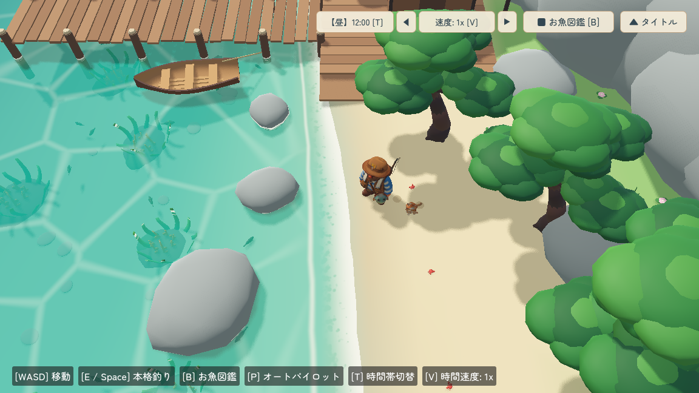
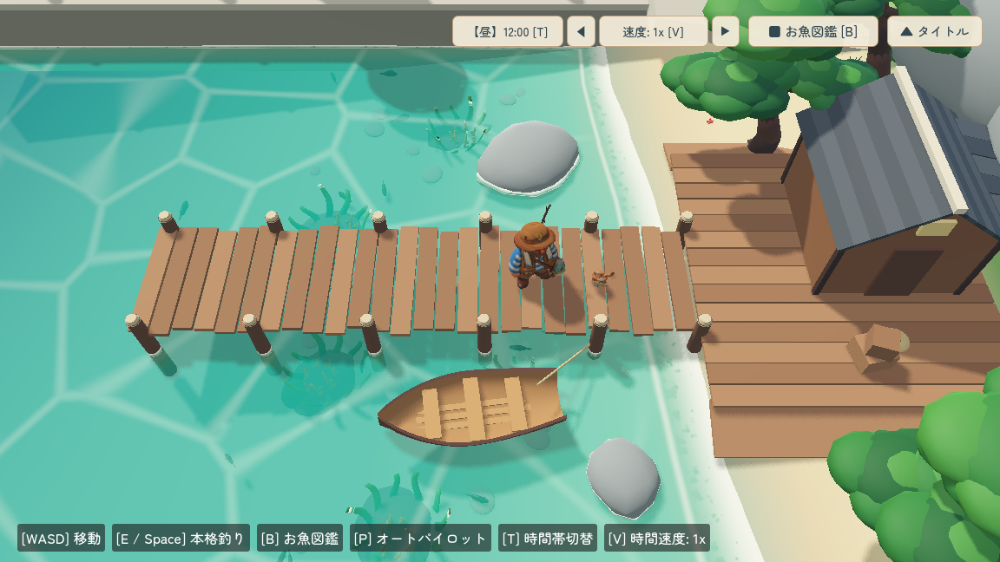
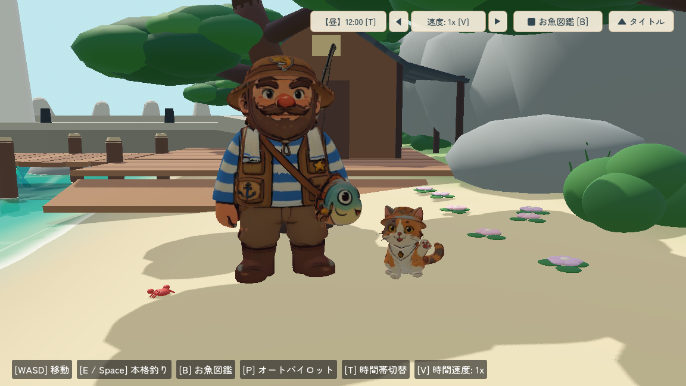
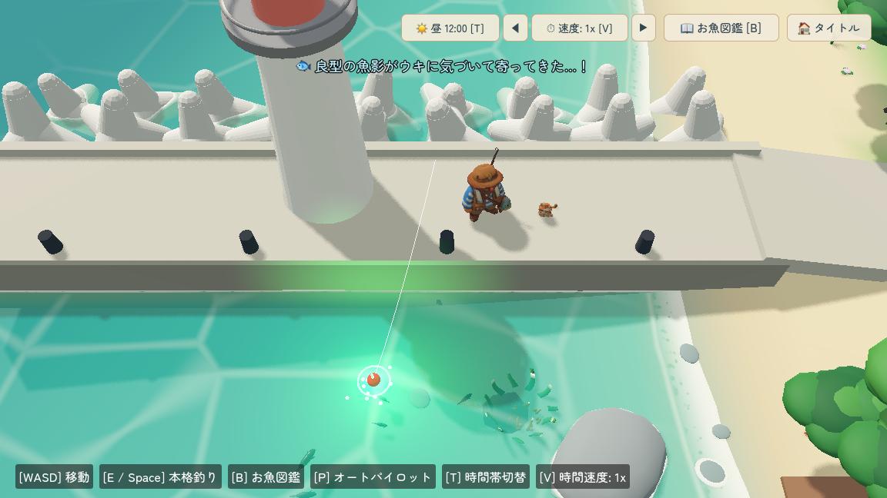
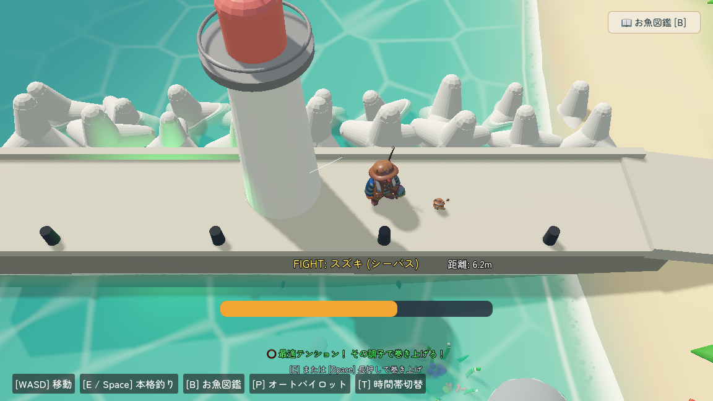
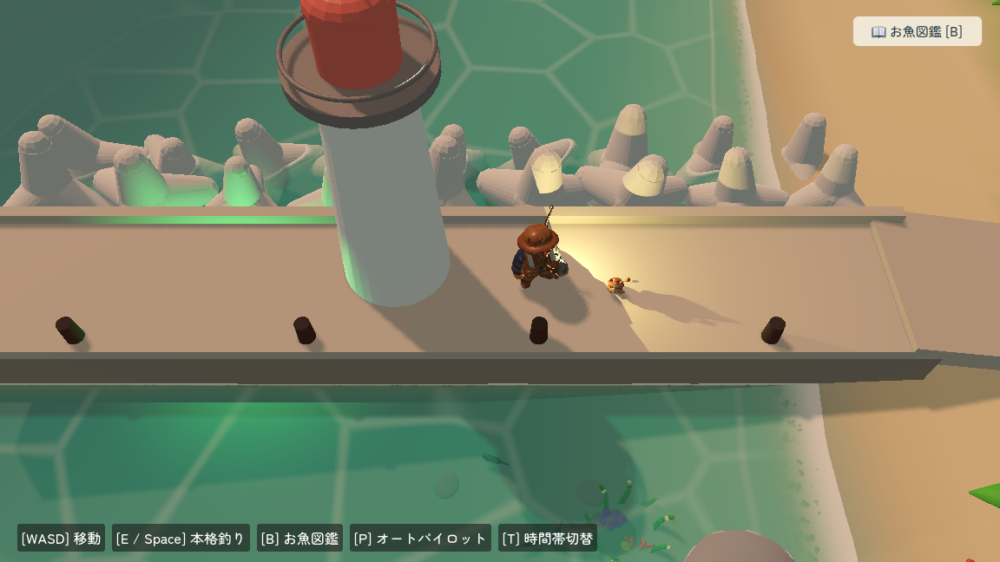
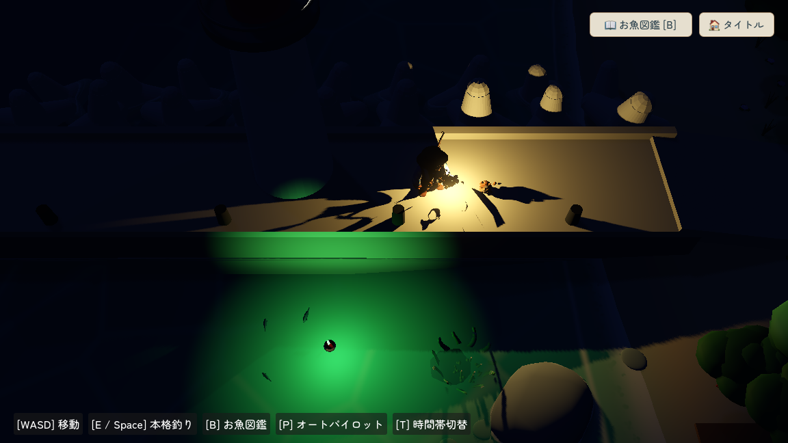

# 🌊 うみかぜ日和 〜 日本全国お魚釣り旅：福岡・糸島 野北編 〜

   
  👉 <strong><a href="https://nory74-ui.github.io/cozy-fishing-game/">https://nory74-ui.github.io/cozy-fishing-game/</a></strong> 
  <em>（インストール不要！PCのブラウザですぐにフル3Dプレイできます）</em>

---

## 📸 ゲーム画面

  

  
  

  
  

  
  

---

## 📖 ゲーム概要

『うみかぜ日和』は、福岡県糸島市・野北海岸の豊かな自然環境を舞台にしたフル3Dオープンワールド釣りゲームです。

透き通るエメラルド・ターコイズの玄界灘、多角形ボロノイ網目のコースティクスが揺らぐ水面、波打ち際と浅瀬岩を包むレース状の白波、風にそよぐ海浜松、木造小舟、そして北側に延びる野北漁港の大波止と白灯台。
バーロック船長と相棒の三毛猫ミケと一緒に、広大な海岸線を探索し、四季折々の玄界灘の魚たちとのファイトを楽しみましょう！

---

## ✨ 主な特徴

### 1. 🌊 美麗なスタイライズド水面＆コースティクス
- **ボロノイ網目コースティクス**: シャープで美しい光の屈折網目が海面と海底を照らします。
- **レース白波＆浅瀬の泡**: 波打ち際や海中の岩礁の周りに自然な白い泡セルが生まれます。
- **海中の生態系**: ピンクの枝サンゴ、紫の管サンゴ、揺れる緑の海藻リーフ、そしてダークスレート色の3D回遊小魚の群れが泳ぎます。

### 2. 🚶 Tripo3D ✕ Blender 最適化キャラクター
- **バーロック船長**: デニムフィッシングベスト、麦わらハット、腰の魚型ポシェット、背負いロッドを備えた3Dキャラクター。
- **相棒の三毛猫ミケ**: 首元の黄色い鈴とバケットハットを被った愛らしい幸運の三毛猫。
- **段差乗り越え＆落下防止ガード**: 砂浜・木製ロング桟橋・大波止（防波堤）を自由に歩き回れ、海へ落ちない安心設計。

### 3. 🎣 リアルな釣りコントロール＆ファイト
- **キャスト**: `Space` キーで狙いを定めてウキをキャスト。
- **アワセ**: ウキが沈んだ瞬間にタイミングよくフッキング！
- **ファイト**: 暴れる大物とのリアルタイムのテンションゲージ＆リール巻き上げバトル！
- **時間帯サイクル**: 昼・夕凪（サンセット）・夜・朝の情景変化（`T` キーで切り替え可能）。

### 4. 📚 糸島・野北のお魚図鑑（全12種）
玄界灘を代表する魚たちの詳細な生態と釣り場の特徴を徹底収録：
- **マダイ（真鯛）** - 百魚の王、玄界灘の誇り
- **スズキ（シーバス）** - 磯場を疾走する銀鱗の王者
- **ヒラメ（平目）** - 砂底に潜む海底の暗殺者
- **アオリイカ** - 水光を放つ烏賊の王様
- **キジハタ（アコウ）** - 玄界灘の超高級根魚
- **アラカブ（カサゴ）** - 岩礁帯の愛され根魚
- **マゴチ** - 照りゴチの異名を持つ夏フグ
- **アジ（真鯵）** - 群れで回遊する銀白の旨魚
- **シロギス** - 砂浜の白い貴婦人
- **クロダイ（チヌ）** - 磯の銀狼、警戒心の強い強敵
- **イシダイ（石鯛）** - 磯の王者、鋼の引き
- **ブリ（ヤズ〜ワラサ）** - 荒波を泳ぐ青物の代表格

---

## 🎮 操作方法

| キー / 操作 | アクション |
| :--- | :--- |
| **W / A / S / D** または **方向キー** | 移動（砂浜・木製桟橋・大波止） |
| **Space** または **左クリック** | キャスト / フッキング / リール巻き |
| **B** キー | お魚図鑑を開く / 閉じる |
| **T** キー | 時間帯切り替え（昼 ⇄ 夕 ⇄ 夜 ⇄ 朝） |
| **Esc** キー | モーダルを閉じる |

---

## 🛠 動作環境

- **エンジン**: Godot Engine 4.3+ / 4.6 (Compatibility / WebGL 2.0 対応)
- **3Dモデリング・クリーンアップ**: Blender 5.2
- **ブラウザ実行**: Google Chrome, Safari, Firefox, Edge（WebAssembly & WebGL 2.0 対応ブラウザ）
